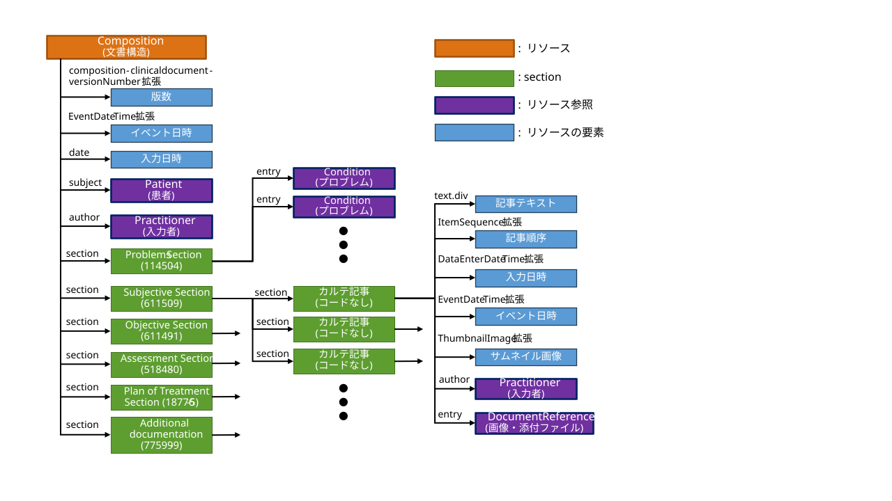

# JP Core Composition ProgressNote Profile - HL7 FHIR JP Core ImplementationGuide v1.3.0-dev

* [**Table of Contents**](toc.md)
* [**Artifacts Summary**](artifacts.md)
* **JP Core Composition ProgressNote Profile**

## Resource Profile: JP Core Composition ProgressNote Profile 

* **項目**: *定義URL*
  * **内容**: http://jpfhir.jp/fhir/core/StructureDefinition/JP_Composition_ProgressNote
* **項目**: *Version*
  * **内容**: 1.3.0-dev
* **項目**: *Name*
  * **内容**: JP_Composition_ProgressNote
* **項目**: *Title*
  * **内容**: JP Core Composition ProgressNote Profile
* **項目**: *Status*
  * **内容**: Active ( 2026-11-01 )
* **項目**: *Copyright*
  * **内容**: Copyright Japan FHIR Implementation Infrastructure Study Group in Japan Association of Medical Informatics (JAMI) 一般社団法人日本医療情報学会FHIR国内実装基盤研究会

 
このプロファイルは、Compositionリソースに対して、SOAP形式の経過記録等に関する情報を送受信するための共通の制約と拡張を定めたものである。 

## スコープ

JP_Composition_ProgressNoteプロファイル（以下、「本プロファイル」）のスコープは以下のとおりとする。

* SOAP形式で記述された記録全般を対象とする。電子カルテで医師が入力した経過記録が中心になるが、SOAP形式であれば経過記録であるかどうかや記載者が医師であるかどうかは問わない。
* DAR形式の看護記録や構造を持たない一般的な記録については、別にプロファイルを定義することとし、本プロファイルの対象としない。

## 想定シナリオ

本プロファイルは、以下のようなユースケースを想定する。

* SOAP形式の経過記録を電子カルテFHIR変換アダプタで出力して、外部システムで利用する
* 地域連携システムにおいてSOAP形式の経過記録を電子的に情報交換する
* 電子カルテに蓄積されたSOAP形式の経過記録を生成AIのインプットとして利用する

## プロファイル定義

**Usages:**

* Examples for this Profile: [Composition/jp-composition-progressnote-example-1](Composition-jp-composition-progressnote-example-1.md)

You can also check for [usages in the FHIR IG Statistics](https://packages2.fhir.org/xig/jpfhir.jp.core|current/StructureDefinition/jp-composition-progressnote)

### プロファイル詳細

 [Description of Profiles, Differentials, Snapshots and how the different presentations work](http://build.fhir.org/ig/FHIR/ig-guidance/readingIgs.html#structure-definitions). 

 

Other representations of profile: [CSV](StructureDefinition-jp-composition-progressnote.csv), [Excel](StructureDefinition-jp-composition-progressnote.xlsx), [Schematron](StructureDefinition-jp-composition-progressnote.sch) 

### 必須要素

本プロファイルに準拠するためには、次の項目の値が存在しなければならない。

* status : 記録のステータス
* type : 記録の種別
* subject : 記録が書かれた対象の患者
* date : 記録の作成日時
* author : 記録の作成者
* title : 記録の人間向けのタイトル

### Extensions定義

本プロファイルで定義された拡張は次の通りである。

| | | | |
| :--- | :--- | :--- | :--- |
| イベント日時 | 記録/記事が書かれた対象の日時《リソース直下ないしsection.section配下》 | [JP_Common_Department](StructureDefinition-jp-common-department.md) | CodeableConcept |
| 記事順序 | 記事ごとの記載順序《section.section配下》 | [JP_Composition_ItemSequence](StructureDefinition-jp-composition-itemsequence.md) | integer |
| 記事入力日時 | 記事ごとの入力日時《section.section配下》 | [JP_Composition_DataEnterDateTime](StructureDefinition-jp-composition-dataenterdatetime.md) | dateTime |
| サムネイル画像 | 添付ファイルや添付画像のサムネイル画像《section.section配下》 | [JP_Composition_ThumbnailImage](StructureDefinition-jp-composition-thumnailimage.md) | Attachment |

### 使用するセクション

本プロファイルで参考にした [C-CDA on FHIR Progress Note](https://hl7.org/fhir/us/ccda/StructureDefinition-Progress-Note.html) では多様なセクションが定義されているが、本プロファイルでは、そのうち以下のセクションを使用する。いずれもLOINCコードである。

| | | |
| :--- | :--- | :--- |
| 11450-4 | Problems Section | 対象プロブレム |
| 61150-9 | Subjective Section | S欄 |
| 61149-1 | Objective Section | O欄 |
| 51848-0 | Assessment Section | A欄 |
| 18776-5 | Plan of Treatment Section | P欄 |
| 77599-9 | Additional documentation | その他（フリー欄） |

### 制約一覧

本プロファイルで追加された制約は以下の通りである。

* type : ValueSet「[JP_Composition_ProgressNote_Type_VS](ValueSet-jp-composition-progressnote-type-vs.md)」 の使用を推奨する。経過記録の場合、LOINCコード「11506-3」(Progress note)となる。
* subject : 本プロファイルでは必須とする
* section : 上記「使用するセクション」で定義されたセクションに限定する

### 項目の追加

本プロファイルで追加された項目は以下の通りである。

* 版数（拡張「composition-clinicaldocument-versionNumber」を使用）：記録の版数
* 診療科（拡張「[JP_Common_Department](StructureDefinition-jp-common-department.md)」を使用）：記録が書かれた診療科
* 記録種別（type要素、category要素を使用）：記録の種別
* イベント日時（拡張「[JP_Composition_EventDateTime](StructureDefinition-jp-composition-eventdatetime.md)」を使用）：記録/記事が書かれた対象の日時。対象日時は通常date要素と同じになるが、事後入力によりdate要素と異なる場合に使用する。
* 対象患者（subject要素を使用）：記録の対象となった患者
* 入力日時（date要素を使用）：記録全体を入力した日時
* 入力者（author要素を使用）：記録全体を入力した医療従事者
* タイトル（title要素を使用）：記録全体のタイトル
* 記事順序（拡張「[JP_Composition_ItemSequence](StructureDefinition-jp-composition-itemsequence.md)」を使用）：同一セクション内での記事の記録順序
* 記事入力日時（拡張「[JP_Composition_DataEnterDateTime](StructureDefinition-jp-composition-dataenterdatetime.md)」を使用）：記事を入力した日時。記事の入力日時は通常date要素と同じになるが、確定後の追記によりdate要素と異なる場合に使用する。
* 記事入力者（section.section.authorを使用）：記事を入力した医療従事者
* 記事テキスト（section.section.textを使用）：記事のテキスト
* サムネイル画像（拡張「[JP_Composition_ThumbnailImage](StructureDefinition-jp-composition-thumnailimage.md)」を使用）：添付ファイルや添付画像のサムネイル画像

## 利用方法

### OperationおよびSearch Parameter 一覧

#### Search Parameter一覧

| | | | |
| :--- | :--- | :--- | :--- |
| SHALL | identifier | token | GET [base]/Compoisition?identifier=http://myhospital.com/fhir/Compoisition|123 |
| SHOULD | patient | reference | GET [base]/Compoisition?patient=Patient/123 |
| MAY | patient,type | reference,token | GET [base]/Compoisition?patient=Patient/123&type=11506-3 |
| MAY | patient,date | reference,date | GET [base]/Compoisition?patient=Patient/123&date=ge2026-08-24 |
| MAY | patient,type,date | reference,token,date | GET [base]/Compoisition?patient=Patient/123&type=11506-3&date=ge2026-08-24 |

##### 必須検索パラメータ

本プロファイルに準拠するためには、以下の検索パラメータをサポートしなければならない（SHALL）

1. 検索パラメータidentifierを指定し、レコードIDなどの識別子によりCompoisitionを検索

```
GET [base]/Compoisition?identifier={system|}[code]

```

例：

```
GET [base]/Compoisition?identifier=http://myhospital.com/fhir/Compoisition|123

```

指定された識別子に一致するCompoisitionリソースを含むBundleを検索する。

##### 推奨検索パラメータ

本プロファイルに準拠するためには、以下の検索パラメータをサポートすることが推奨される（SHOULD）

1. 検索パラメータpatientを指定し、該当するすべてのCompoisitionを検索

```
GET [base]/Compoisition?patient={reference}

```

例：

```
GET [base]/Compoisition?patient=Patient/123

```

指定された患者のすべてのCompoisitionリソースを含むBundleを検索する。

##### 追加検索パラメータ

オプションとして次の検索パラメータをサポートすることができる（MAY）

1. 検索パラメータpatientとtypeを指定し、該当するすべてのCompoisitionを検索

```
   GET [base]/Compoisition?patient={reference}&type={type}

```

例：

```
   GET [base]/Compoisition?patient=Patient/123&type=11506-3

```

指定された患者および記録種別のすべてのCompoisitionを含むBundleを検索する。
1. 検索パラメータpatientとdateを指定し、該当するすべてのCompoisitionを検索
* dateに対する次の比較演算子のサポートを含む: gt,lt,ge,le
* AND検索のオプションのサポートを含む (例えば.date=[date]&date=[date]&…)

```
   GET [base]/Compoisition?patient={reference}&date={gt|lt|ge|le}[date]{&date={gt|lt|ge|le}[date]&...}

```

例：

```
   GET [base]/Compoisition?patient=Patient/123&date=ge2026-08-24

```

指定された患者および入力日のすべてのCompoisitionを含むBundleを検索する。
1. 検索パラメータpatient, type, dateを指定し、該当するすべてのCompoisitionを検索
* dateに対する次の比較演算子のサポートを含む: gt,lt,ge,le
* AND検索のオプションのサポートを含む (例えば.date=[date]&date=[date]&…)

```
   GET [base]/Compoisition?patient={reference}&type={type}&date={gt|lt|ge|le}[date]{&date={gt|lt|ge|le}[date]&...}

```

例：

```
   GET [base]/Compoisition?patient=Patient/123&type=11506-3&date=ge2026-08-24

```

```
   GET [base]/Compoisition?patient=Patient/123&type=11506-3&date=ge2026-08-24

```

指定された患者、記録種別、入力日のすべてのCompoisitionを含むBundleを検索する。

##### オプション検索パラメータ

本プロファイルで追加定義されたオプション検索パラメータはない。

#### サンプル

* [**経過記録**](Composition-jp-composition-progressnote-example-1.md)

## 注意事項

### Compositionリソースの全体構造

本プロファイルにおけるCompositionリソースの全体構造を下図に示す。



### 記録の種別について

記録の種別はtype要素を使用してCodeableConcept型で記述する。使用するコードは、ValueSet「[JP_Composition_ProgressNote_Type_VS](ValueSet-jp-composition-progressnote-type-vs.md)」を推奨するが、このValueSetにない場合には、それ以外のLOINCコードやローカルコードを使用してもよい。

category要素には、type要素と同じ値を指定することを推奨するが、多重度が「0..*」であるため、検索時に有用と思われるそれ以外の分類コードを追加指定してもよい。

### 対象プロブレムの記述方法について

記録の対象となったプロブレムがある場合、 「Problems Section」セクション（LOINCコード「11450-4」）で記述する。複数プロブレムを記載することが可能で、entry要素から対象プロブレムのConditionリソースを参照し、entry.display要素でプロブレム名を記載する。

「D#0 全体に関係 (医師)」と「D#1 ＲＳウイルス肺炎」の２つのプロブレムを対象とした場合のインスタンス例を示す。

```
 "section": [ {
    "title": "Problems Section",
    "code": {
      "coding": [ {
        "system": "http://loinc.org",
        "code": "11450-4",
        "display": "Problems Section"
      } ]
    },
    "entry": [ {
      "reference": "Condition/00000040.-3.0",
      "display": "D#0　全体に関係 (医師)"
    }, {
      "reference": "Condition/00000040.3.0",
      "display": "D#1　ＲＳウイルス肺炎"
    } ]
  } ]

```

### 記事テキストの記述方法について

C-CDA on FHIRのProgress Noteでは、セクションごとのインスタンスは最大１個に制限されている一方、日本の電子カルテシステムの実装では複数の記事が記載できる場合がある。そこで、本プロファイルでは、常にサブセクション（section.section要素）を使用して記事を記述することとする。記事テキストは、サブセクションのtext.div要素にXHTML形式で記述する。

O欄に複数の記事を記載した場合のインスタンス例を示す。

```
  "section": [ {
    "title": "Objective Section",
    "code": {
      "coding": [ {
        "system": "http://loinc.org",
        "code": "61149-1",
        "display": "Objective Section"
      } ]
    },
    "section": [ {
      "entry": [ {
        "reference": "DocumentReference/00000040.20240819.110720.Z999.1.20.000.-3.O00.0"
      } ]
    }, {
      "text": {
        "status": "additional",
        "div": "<div xmlns=\"http://www.w3.org/1999/xhtml\"><p>下肺野の過膨張や肺炎の影が見られ、ウイルス性の肺炎と思われる。</p><p/></div>"
      }
    }, {
      "text": {
        "status": "additional",
        "div": "<div xmlns=\"http://www.w3.org/1999/xhtml\"><p>【検体検査結果】</p><p>生化学Ａ,糖・有機酸,尿定量（新尿）,尿一般,血液一般 採取日時：2024-08-19 </p><p>総蛋白                         4.7</p><p>TP(その他)                     0.5</p><p><b>ALB                     H 41</b></p><p>C3                             </p><p/></div>"
      }
    } ]
  } ]

```

### 記録の版数の記述方法について

記録の版数を記述するには、FHIRで定義されている「composition-clinicaldocument-versionNumber」拡張を使用して、string型で記述する。url要素の値は「http://hl7.org/fhir/StructureDefinition/composition-clinicaldocument-versionNumber」とする。版数の形式は実装依存とし、本プロファイルでは規定しない。

版数「2」の場合のインスタンス例を示す。

```
  "extension": [ {
    "url": "http://hl7.org/fhir/StructureDefinition/composition-clinicaldocument-versionNumber",
    "valueString": "2"
  } ]

```

### 診療科の記述方法について

記録を記載した診療科は、Compositionリソースの標準的な要素では記述が難しいため、JP Coreで定義されている「[JP_Common_Department](StructureDefinition-jp-common-department.md)」拡張を使用してCodeabacleConcept型で記述する。使用する標準コードはSS-MIX2診療科コードを推奨する。

診療科が「内科」の場合のインスタンス例を示す。

```
  "extension": [ {
    "url": "http://jpfhir.jp/fhir/core/Extension/StructureDefinition/JP_Common_Department",
    "valueCodeableConcept": {
      "coding": [ {
        "system": "http://jami.jp/SS-MIX2/CodeSystem/ClinicalDepartment",
        "code": "01",
        "display": "内科"
      } ]
    }
  } ]

```

### イベント日時の記述方法について

イベント日時は、記録/記事が書かれた対象の日時のことで、通常date要素と同じ値になるはずであるが、いわゆる事後入力によりdate要素と異なる値になる場合には、拡張「[JP_Composition_EventDateTime](StructureDefinition-jp-composition-eventdatetime.md)」を使用してdateTime型で記述する。

イベント日時が「2026-08-19 11:00:00」の場合のインスタンス例を示す。

```
  "extension": [ {
    "url": "http://jpfhir.jp/fhir/core/Extension/StructureDefinition/JP_Composition_EventDateTime",
    "valueDateTime": "2026-08-19T11:00:00+09:00"
  } ],

```

### 入力日時の記述方法について

記録全体の入力日時は、date要素を使用してdateTime型で記述する。

入力日時が「2026-08-19 11:00:02」の場合のインスタンス例を示す。

```
  "date": "2026-08-19T11:00:02+09:00"

```

### 入力者の記述方法について

記録全体の入力者は、author要素を使用して、Reference型で入力者を記述したPractitioner等のリソースを参照する。

入力者が「Practitioner/1234567」の場合のインスタンス例を示す。

```
  "author": [ {
    "reference": "Practitioner/1234567"
  } ]

```

### タイトルの記述方法について

タイトルは必須要素であるtitle要素を使用して、string型で記述する。本プロファイルでは、「経過記録」など記録種別の名称を記載することを推奨するが、記録ごとのタイトルがあればそれを記載してもよい。

タイトルが「経過記録」の場合のインスタンス例を示す。

```
  "title": "経過記録"

```

### 記事順序の記述方法について

同一のSOAP種別に複数の記事があるとサブセクション(section.section)が複数並ぶことになるが、その並び順を明示したい場合、サブセクションの「[JP_Composition_ItemSequence](StructureDefinition-jp-composition-itemsequence.md)」拡張を使用して、同一SOAP種別内での記事の記録順序をinteger型で記述する。

記事順序を明示した場合のインスタンス例を示す。

```
  "section": [ {
    "title": "Objective Section",
    "code": {
      "coding": [ {
        "system": "http://loinc.org",
        "code": "61149-1",
        "display": "Objective Section"
      } ]
    },
    "section": [ {
      "extension": [ {
        "url": "http://jpfhir.jp/fhir/core/Extension/StructureDefinition/JP_Composition_ItemSequence",
        "valueInteger": 1
      } ],
      "text": {
        "status": "additional",
        "div": "<div xmlns=\"http://www.w3.org/1999/xhtml\"><p>臥床がちに過ごす。顔色不良。バイタルは著変無し。本日心内受診予定であったが、混んでいたため、明日に変更となる。</p></div>"
      }
    }, {
      "extension": [ {
        "url": "http://jpfhir.jp/fhir/core/Extension/StructureDefinition/JP_Composition_ItemSequence",
        "valueInteger": 2
      } ],
      "text": {
        "status": "additional",
        "div": "<div xmlns=\"http://www.w3.org/1999/xhtml\"><p>ﾊﾟｯﾁﾃｽﾄ施行する。25日判定とする。掻痒感出現時は伝えるように話す。</p></div>"
      }
    }, {
      "extension": [ {
        "url": "http://jpfhir.jp/fhir/core/Extension/StructureDefinition/JP_Composition_ItemSequence",
        "valueInteger": 3
      } ],
      "text": {
        "status": "additional",
        "div": "<div xmlns=\"http://www.w3.org/1999/xhtml\"><p>尿混濁あるため〇〇Ｄｒよりﾊﾟﾝｽﾎﾟﾘﾝの処方あり。</p></div>"
      }
    } ]
  } ]

```

### 記事入力日時の記述方法について

記事ごとの入力日時は通常date要素と同じ値になるが、確定後の追記によりdate要素と異なる値となる場合がある。その場合、サブセクションの「[JP_Composition_DataEnterDateTime](StructureDefinition-jp-composition-dataenterdatetime.md)」拡張を使用して、dateTime型で記述する。

下記はO欄の一部の記事のみ入力日時が異なる場合のインスタンス例を示す。

```
  "date": "2024-08-19T11:00:02+09:00",
  "author": [ {
    "reference": "Practitioner/1234567"
  } ],
  "section": [ {
    "title": "Objective Section",
    "code": {
      "coding": [ {
        "system": "http://loinc.org",
        "code": "61149-1",
        "display": "Objective Section"
      } ]
    },
    "section": [ {
      "entry": [ {
        "reference": "DocumentReference/00000040.20240819.110720.Z999.1.20.000.-3.O00.0"
      } ]
    }, {
      "extension": [ {
        "url": "http://jpfhir.jp/fhir/core/Extension/StructureDefinition/JP_Composition_DataEnterDateTime",
        "valueDateTime": "2024-08-19T11:07:20+09:00"
      } ],
      "author": [ {
        "reference": "Practitioner/1000231"
      } ],
      "text": {
        "status": "additional",
        "div": "<div xmlns=\"http://www.w3.org/1999/xhtml\"><p>下肺野の過膨張や肺炎の影が見られ、ウイルス性の肺炎と思われる。</p><p/></div>"
      }
    }, {
      "extension": [ {
        "url": "http://jpfhir.jp/fhir/core/Extension/StructureDefinition/JP_Composition_DataEnterDateTime",
        "valueDateTime": "2024-08-19T11:00:02+09:00"
      } ],
      "text": {
        "status": "additional",
        "div": "<div xmlns=\"http://www.w3.org/1999/xhtml\"><p>【検体検査結果】</p><p>生化学Ａ,糖・有機酸,尿定量（新尿）,尿一般,血液一般 採取日時：2024-08-19 </p><p>総蛋白                         4.7</p><p>TP(その他)                     0.5</p><p><b>ALB                     H 41</b></p><p>C3                             </p><p/></div>"
      }
    } ]
  } ]

```

### 記事入力者の記述方法について

記事ごとの入力者は通常記録全体の入力者であるauthor要素の値と同じになるが、確定後の追記で異なる医療従事者が入力した場合は異なる値になる。そのような場合、サブセクションのauthor要素を使用して記事ごとの入力者を記述する。

インスタンス例については、前節の記事入力日時を参照のこと。

### 添付ファイル、添付画像とそのサムネイル画像の記述方法について

記事に張り付けた添付ファイルや添付画像は、DocumentReferenceリソースを使用して記述し、サブセクションのentry要素から参照することとする。DocumentReferenceでの記述方法は本プロファイルでは規定しない。

また、添付ファイルや添付画像のサムネイル画像を記述するには、サブセクションの「[JP_Composition_ThumbnailImage](StructureDefinition-jp-composition-thumnailimage.md)」拡張を使用して、Attachment型で記述する。画像データはdata要素にBase64でエンコードしたテキストとしてセットし、そのMIMEタイプをcontentType要素にセットする。

添付画像本体とサムネイル画像のインスタンス例を示す。（サムネイル画像の画像データは先頭部分のみ）

```
  "section": [ {
    "title": "Objective Section",
    "code": {
      "coding": [ {
        "system": "http://loinc.org",
        "code": "61149-1",
        "display": "Objective Section"
      } ]
    },
    "section": [ {
      "extension": [ {
        "url": "http://jpfhir.jp/fhir/core/Extension/StructureDefinition/JP_Composition_ThumnailImage",
        "valueAttachment": {
          "contentType": "image/jpeg",
          "data": "/9j/4AAQSkZJRgABAQAAAQABAAD/..."
        }
      } ],
      "entry": [ {
        "reference": "DocumentReference/00000040.20240819.110720.Z999.1.20.000.-3.O00.0"
      } ]
    } ]
  } ]

```

## その他、参考文献・リンク等

1. C-CDA on FHIR Progress Note[https://hl7.org/fhir/us/ccda/StructureDefinition-Progress-Note.html](https://hl7.org/fhir/us/ccda/StructureDefinition-Progress-Note.html)
1. JAHIS地域医療連携における経過記録構造化記述規約 Ver.1.0[https://www.jahis.jp/files/user/04_JAHIS%20standard/17-007_JAHIS%E5%9C%B0%E5%9F%9F%E5%8C%BB%E7%99%82%E9%80%A3%E6%90%BA%E3%81%AB%E3%81%8A%E3%81%91%E3%82%8B%E7%B5%8C%E9%81%8E%E8%A8%98%E9%8C%B2%E6%A7%8B%E9%80%A0%E5%8C%96%E8%A8%98%E8%BF%B0%E8%A6%8F%E7%B4%84Ver.1.0.pdf](https://www.jahis.jp/files/user/04_JAHIS%20standard/17-007_JAHIS%E5%9C%B0%E5%9F%9F%E5%8C%BB%E7%99%82%E9%80%A3%E6%90%BA%E3%81%AB%E3%81%8A%E3%81%91%E3%82%8B%E7%B5%8C%E9%81%8E%E8%A8%98%E9%8C%B2%E6%A7%8B%E9%80%A0%E5%8C%96%E8%A8%98%E8%BF%B0%E8%A6%8F%E7%B4%84Ver.1.0.pdf)

本実装ガイドへのご質問・ご指摘については、
[GitHub Issue](https://github.com/jami-fhir-jp-wg/jp-core-v1x/issues)および
[GitHub PullRequest](https://github.com/jami-fhir-jp-wg/jp-core-v1x/pulls)にて受け付けている。

## Resource Content

```json
{
  "resourceType" : "StructureDefinition",
  "id" : "jp-composition-progressnote",
  "url" : "http://jpfhir.jp/fhir/core/StructureDefinition/JP_Composition_ProgressNote",
  "version" : "1.3.0-dev",
  "name" : "JP_Composition_ProgressNote",
  "title" : "JP Core Composition ProgressNote Profile",
  "status" : "active",
  "date" : "2026-11-01",
  "publisher" : "FHIR Japanese implementation research working group in Japan Association of Medical Informatics (JAMI)",
  "contact" : [
    {
      "name" : "FHIR Japanese implementation research working group in Japan Association of Medical Informatics (JAMI)",
      "telecom" : [
        {
          "system" : "url",
          "value" : "http://jpfhir.jp"
        },
        {
          "system" : "email",
          "value" : "office@hlfhir.jp"
        }
      ]
    }
  ],
  "description" : "このプロファイルは、Compositionリソースに対して、SOAP形式の経過記録等に関する情報を送受信するための共通の制約と拡張を定めたものである。",
  "jurisdiction" : [
    {
      "coding" : [
        {
          "system" : "urn:iso:std:iso:3166",
          "code" : "JP",
          "display" : "Japan"
        }
      ]
    }
  ],
  "copyright" : "Copyright Japan FHIR Implementation Infrastructure Study Group in Japan Association of Medical Informatics (JAMI) 一般社団法人日本医療情報学会FHIR国内実装基盤研究会",
  "fhirVersion" : "4.0.1",
  "mapping" : [
    {
      "identity" : "workflow",
      "uri" : "http://hl7.org/fhir/workflow",
      "name" : "Workflow Pattern"
    },
    {
      "identity" : "rim",
      "uri" : "http://hl7.org/v3",
      "name" : "RIM Mapping"
    },
    {
      "identity" : "cda",
      "uri" : "http://hl7.org/v3/cda",
      "name" : "CDA (R2)"
    },
    {
      "identity" : "fhirdocumentreference",
      "uri" : "http://hl7.org/fhir/documentreference",
      "name" : "FHIR DocumentReference"
    },
    {
      "identity" : "w5",
      "uri" : "http://hl7.org/fhir/fivews",
      "name" : "FiveWs Pattern Mapping"
    }
  ],
  "kind" : "resource",
  "abstract" : false,
  "type" : "Composition",
  "baseDefinition" : "http://hl7.org/fhir/StructureDefinition/Composition",
  "derivation" : "constraint",
  "differential" : {
    "element" : [
      {
        "id" : "Composition",
        "path" : "Composition",
        "short" : "SOAP形式の経過記録等に関する詳細な情報",
        "definition" : "SOAP形式の経過記録等に関する詳細な情報"
      },
      {
        "id" : "Composition.extension",
        "path" : "Composition.extension",
        "slicing" : {
          "discriminator" : [
            {
              "type" : "value",
              "path" : "url"
            }
          ],
          "rules" : "open"
        }
      },
      {
        "id" : "Composition.extension:versionNumber",
        "path" : "Composition.extension",
        "sliceName" : "versionNumber",
        "short" : "記録の版数",
        "definition" : "記録の版数。形式は実装依存とし、本プロファイルでは規定しない。",
        "min" : 0,
        "max" : "1",
        "type" : [
          {
            "code" : "Extension",
            "profile" : [
              "http://hl7.org/fhir/StructureDefinition/composition-clinicaldocument-versionNumber|5.4.0"
            ]
          }
        ]
      },
      {
        "id" : "Composition.extension:department",
        "path" : "Composition.extension",
        "sliceName" : "department",
        "min" : 0,
        "max" : "1",
        "type" : [
          {
            "code" : "Extension",
            "profile" : [
              "http://jpfhir.jp/fhir/core/Extension/StructureDefinition/JP_Common_Department"
            ]
          }
        ]
      },
      {
        "id" : "Composition.extension:eventDateTime",
        "path" : "Composition.extension",
        "sliceName" : "eventDateTime",
        "min" : 0,
        "max" : "1",
        "type" : [
          {
            "code" : "Extension",
            "profile" : [
              "http://jpfhir.jp/fhir/core/Extension/StructureDefinition/JP_Composition_EventDateTime"
            ]
          }
        ]
      },
      {
        "id" : "Composition.type",
        "path" : "Composition.type",
        "short" : "記録の種別",
        "definition" : "記録の種別を表すコード。",
        "mustSupport" : true,
        "binding" : {
          "strength" : "preferred",
          "valueSet" : "http://jpfhir.jp/fhir/core/ValueSet/JP_Composiiton_ProgressNote_Type_VS"
        }
      },
      {
        "id" : "Composition.type.coding.system",
        "path" : "Composition.type.coding.system",
        "min" : 1
      },
      {
        "id" : "Composition.type.coding.code",
        "path" : "Composition.type.coding.code",
        "min" : 1
      },
      {
        "id" : "Composition.subject",
        "path" : "Composition.subject",
        "short" : "記録の対象患者",
        "definition" : "記録の対象となった患者",
        "min" : 1,
        "mustSupport" : true
      },
      {
        "id" : "Composition.date",
        "path" : "Composition.date",
        "short" : "記録の作成日時",
        "definition" : "記録を作成した日時",
        "mustSupport" : true
      },
      {
        "id" : "Composition.author",
        "path" : "Composition.author",
        "short" : "記録の作成者",
        "definition" : "記録を作成した人物",
        "mustSupport" : true
      },
      {
        "id" : "Composition.title",
        "path" : "Composition.title",
        "short" : "記録の人間向けのタイトル",
        "definition" : "記録の人間向けのタイトル"
      },
      {
        "id" : "Composition.section",
        "path" : "Composition.section",
        "slicing" : {
          "discriminator" : [
            {
              "type" : "value",
              "path" : "code"
            }
          ],
          "rules" : "open"
        },
        "short" : "セクション",
        "definition" : "セクション"
      },
      {
        "id" : "Composition.section.title",
        "path" : "Composition.section.title",
        "min" : 1,
        "mustSupport" : true
      },
      {
        "id" : "Composition.section.code",
        "path" : "Composition.section.code",
        "min" : 1,
        "mustSupport" : true
      },
      {
        "id" : "Composition.section.code.coding",
        "path" : "Composition.section.code.coding",
        "min" : 1
      },
      {
        "id" : "Composition.section.code.coding.system",
        "path" : "Composition.section.code.coding.system",
        "min" : 1
      },
      {
        "id" : "Composition.section.code.coding.code",
        "path" : "Composition.section.code.coding.code",
        "min" : 1
      },
      {
        "id" : "Composition.section.text",
        "path" : "Composition.section.text",
        "max" : "0"
      },
      {
        "id" : "Composition.section.section",
        "path" : "Composition.section.section",
        "type" : [
          {
            "code" : "BackboneElement"
          }
        ]
      },
      {
        "id" : "Composition.section.section.extension",
        "path" : "Composition.section.section.extension",
        "slicing" : {
          "discriminator" : [
            {
              "type" : "value",
              "path" : "url"
            }
          ],
          "rules" : "open"
        }
      },
      {
        "id" : "Composition.section.section.extension:eventDateTime",
        "path" : "Composition.section.section.extension",
        "sliceName" : "eventDateTime",
        "min" : 0,
        "max" : "1",
        "type" : [
          {
            "code" : "Extension",
            "profile" : [
              "http://jpfhir.jp/fhir/core/Extension/StructureDefinition/JP_Composition_EventDateTime"
            ]
          }
        ],
        "mustSupport" : true
      },
      {
        "id" : "Composition.section.section.extension:itemSequence",
        "path" : "Composition.section.section.extension",
        "sliceName" : "itemSequence",
        "min" : 0,
        "max" : "1",
        "type" : [
          {
            "code" : "Extension",
            "profile" : [
              "http://jpfhir.jp/fhir/core/Extension/StructureDefinition/JP_Composition_ItemSequence"
            ]
          }
        ],
        "mustSupport" : true
      },
      {
        "id" : "Composition.section.section.extension:thumbnailImage",
        "path" : "Composition.section.section.extension",
        "sliceName" : "thumbnailImage",
        "min" : 0,
        "max" : "1",
        "type" : [
          {
            "code" : "Extension",
            "profile" : [
              "http://jpfhir.jp/fhir/core/Extension/StructureDefinition/JP_Composition_ThumbnailImage"
            ]
          }
        ],
        "mustSupport" : true
      },
      {
        "id" : "Composition.section:problems",
        "path" : "Composition.section",
        "sliceName" : "problems",
        "label" : "Problems Section",
        "short" : "Problems Section",
        "min" : 0,
        "max" : "1",
        "mustSupport" : true
      },
      {
        "id" : "Composition.section:problems.code",
        "path" : "Composition.section.code",
        "patternCodeableConcept" : {
          "coding" : [
            {
              "system" : "http://loinc.org",
              "code" : "11450-4"
            }
          ]
        }
      },
      {
        "id" : "Composition.section:problems.entry",
        "path" : "Composition.section.entry",
        "type" : [
          {
            "code" : "Reference",
            "targetProfile" : ["http://hl7.org/fhir/StructureDefinition/Condition"]
          }
        ]
      },
      {
        "id" : "Composition.section:problems.entry.display",
        "path" : "Composition.section.entry.display",
        "mustSupport" : true
      },
      {
        "id" : "Composition.section:problems.section",
        "path" : "Composition.section.section",
        "max" : "0"
      },
      {
        "id" : "Composition.section:problems.section.extension:eventDateTime",
        "path" : "Composition.section.section.extension",
        "sliceName" : "eventDateTime",
        "min" : 0,
        "max" : "1",
        "type" : [
          {
            "code" : "Extension",
            "profile" : [
              "http://jpfhir.jp/fhir/core/Extension/StructureDefinition/JP_Composition_EventDateTime"
            ]
          }
        ],
        "mustSupport" : true
      },
      {
        "id" : "Composition.section:problems.section.extension:itemSequence",
        "path" : "Composition.section.section.extension",
        "sliceName" : "itemSequence",
        "min" : 0,
        "max" : "1",
        "type" : [
          {
            "code" : "Extension",
            "profile" : [
              "http://jpfhir.jp/fhir/core/Extension/StructureDefinition/JP_Composition_ItemSequence"
            ]
          }
        ],
        "mustSupport" : true
      },
      {
        "id" : "Composition.section:problems.section.extension:thumbnailImage",
        "path" : "Composition.section.section.extension",
        "sliceName" : "thumbnailImage",
        "min" : 0,
        "max" : "1",
        "type" : [
          {
            "code" : "Extension",
            "profile" : [
              "http://jpfhir.jp/fhir/core/Extension/StructureDefinition/JP_Composition_ThumbnailImage"
            ]
          }
        ],
        "mustSupport" : true
      },
      {
        "id" : "Composition.section:subjective",
        "path" : "Composition.section",
        "sliceName" : "subjective",
        "label" : "Subjective Section",
        "short" : "Subjective Section",
        "min" : 0,
        "max" : "1",
        "mustSupport" : true
      },
      {
        "id" : "Composition.section:subjective.code",
        "path" : "Composition.section.code",
        "patternCodeableConcept" : {
          "coding" : [
            {
              "system" : "http://loinc.org",
              "code" : "61150-9"
            }
          ]
        }
      },
      {
        "id" : "Composition.section:subjective.entry",
        "path" : "Composition.section.entry",
        "max" : "0"
      },
      {
        "id" : "Composition.section:subjective.section",
        "path" : "Composition.section.section",
        "min" : 1
      },
      {
        "id" : "Composition.section:subjective.section.extension:eventDateTime",
        "path" : "Composition.section.section.extension",
        "sliceName" : "eventDateTime",
        "min" : 0,
        "max" : "1",
        "type" : [
          {
            "code" : "Extension",
            "profile" : [
              "http://jpfhir.jp/fhir/core/Extension/StructureDefinition/JP_Composition_EventDateTime"
            ]
          }
        ],
        "mustSupport" : true
      },
      {
        "id" : "Composition.section:subjective.section.extension:itemSequence",
        "path" : "Composition.section.section.extension",
        "sliceName" : "itemSequence",
        "min" : 0,
        "max" : "1",
        "type" : [
          {
            "code" : "Extension",
            "profile" : [
              "http://jpfhir.jp/fhir/core/Extension/StructureDefinition/JP_Composition_ItemSequence"
            ]
          }
        ],
        "mustSupport" : true
      },
      {
        "id" : "Composition.section:subjective.section.extension:thumbnailImage",
        "path" : "Composition.section.section.extension",
        "sliceName" : "thumbnailImage",
        "min" : 0,
        "max" : "1",
        "type" : [
          {
            "code" : "Extension",
            "profile" : [
              "http://jpfhir.jp/fhir/core/Extension/StructureDefinition/JP_Composition_ThumbnailImage"
            ]
          }
        ],
        "mustSupport" : true
      },
      {
        "id" : "Composition.section:subjective.section.text",
        "path" : "Composition.section.section.text",
        "mustSupport" : true
      },
      {
        "id" : "Composition.section:objective",
        "path" : "Composition.section",
        "sliceName" : "objective",
        "label" : "Objective Section",
        "short" : "Objective Section",
        "min" : 0,
        "max" : "1",
        "mustSupport" : true
      },
      {
        "id" : "Composition.section:objective.code",
        "path" : "Composition.section.code",
        "patternCodeableConcept" : {
          "coding" : [
            {
              "system" : "http://loinc.org",
              "code" : "61149-1"
            }
          ]
        }
      },
      {
        "id" : "Composition.section:objective.entry",
        "path" : "Composition.section.entry",
        "max" : "0"
      },
      {
        "id" : "Composition.section:objective.section",
        "path" : "Composition.section.section",
        "min" : 1
      },
      {
        "id" : "Composition.section:objective.section.extension:eventDateTime",
        "path" : "Composition.section.section.extension",
        "sliceName" : "eventDateTime",
        "min" : 0,
        "max" : "1",
        "type" : [
          {
            "code" : "Extension",
            "profile" : [
              "http://jpfhir.jp/fhir/core/Extension/StructureDefinition/JP_Composition_EventDateTime"
            ]
          }
        ],
        "mustSupport" : true
      },
      {
        "id" : "Composition.section:objective.section.extension:itemSequence",
        "path" : "Composition.section.section.extension",
        "sliceName" : "itemSequence",
        "min" : 0,
        "max" : "1",
        "type" : [
          {
            "code" : "Extension",
            "profile" : [
              "http://jpfhir.jp/fhir/core/Extension/StructureDefinition/JP_Composition_ItemSequence"
            ]
          }
        ],
        "mustSupport" : true
      },
      {
        "id" : "Composition.section:objective.section.extension:thumbnailImage",
        "path" : "Composition.section.section.extension",
        "sliceName" : "thumbnailImage",
        "min" : 0,
        "max" : "1",
        "type" : [
          {
            "code" : "Extension",
            "profile" : [
              "http://jpfhir.jp/fhir/core/Extension/StructureDefinition/JP_Composition_ThumbnailImage"
            ]
          }
        ],
        "mustSupport" : true
      },
      {
        "id" : "Composition.section:objective.section.text",
        "path" : "Composition.section.section.text",
        "mustSupport" : true
      },
      {
        "id" : "Composition.section:assessment",
        "path" : "Composition.section",
        "sliceName" : "assessment",
        "label" : "Assessment Section",
        "short" : "Assessment Section",
        "min" : 0,
        "max" : "1",
        "mustSupport" : true
      },
      {
        "id" : "Composition.section:assessment.code",
        "path" : "Composition.section.code",
        "patternCodeableConcept" : {
          "coding" : [
            {
              "system" : "http://loinc.org",
              "code" : "51848-0"
            }
          ]
        }
      },
      {
        "id" : "Composition.section:assessment.entry",
        "path" : "Composition.section.entry",
        "max" : "0"
      },
      {
        "id" : "Composition.section:assessment.section",
        "path" : "Composition.section.section",
        "min" : 1
      },
      {
        "id" : "Composition.section:assessment.section.extension:eventDateTime",
        "path" : "Composition.section.section.extension",
        "sliceName" : "eventDateTime",
        "min" : 0,
        "max" : "1",
        "type" : [
          {
            "code" : "Extension",
            "profile" : [
              "http://jpfhir.jp/fhir/core/Extension/StructureDefinition/JP_Composition_EventDateTime"
            ]
          }
        ],
        "mustSupport" : true
      },
      {
        "id" : "Composition.section:assessment.section.extension:itemSequence",
        "path" : "Composition.section.section.extension",
        "sliceName" : "itemSequence",
        "min" : 0,
        "max" : "1",
        "type" : [
          {
            "code" : "Extension",
            "profile" : [
              "http://jpfhir.jp/fhir/core/Extension/StructureDefinition/JP_Composition_ItemSequence"
            ]
          }
        ],
        "mustSupport" : true
      },
      {
        "id" : "Composition.section:assessment.section.extension:thumbnailImage",
        "path" : "Composition.section.section.extension",
        "sliceName" : "thumbnailImage",
        "min" : 0,
        "max" : "1",
        "type" : [
          {
            "code" : "Extension",
            "profile" : [
              "http://jpfhir.jp/fhir/core/Extension/StructureDefinition/JP_Composition_ThumbnailImage"
            ]
          }
        ],
        "mustSupport" : true
      },
      {
        "id" : "Composition.section:assessment.section.text",
        "path" : "Composition.section.section.text",
        "mustSupport" : true
      },
      {
        "id" : "Composition.section:plan",
        "path" : "Composition.section",
        "sliceName" : "plan",
        "label" : "Plan Section",
        "short" : "Plan Section",
        "min" : 0,
        "max" : "1",
        "mustSupport" : true
      },
      {
        "id" : "Composition.section:plan.code",
        "path" : "Composition.section.code",
        "patternCodeableConcept" : {
          "coding" : [
            {
              "system" : "http://loinc.org",
              "code" : "18776-5"
            }
          ]
        }
      },
      {
        "id" : "Composition.section:plan.entry",
        "path" : "Composition.section.entry",
        "max" : "0"
      },
      {
        "id" : "Composition.section:plan.section",
        "path" : "Composition.section.section",
        "min" : 1
      },
      {
        "id" : "Composition.section:plan.section.extension:eventDateTime",
        "path" : "Composition.section.section.extension",
        "sliceName" : "eventDateTime",
        "min" : 0,
        "max" : "1",
        "type" : [
          {
            "code" : "Extension",
            "profile" : [
              "http://jpfhir.jp/fhir/core/Extension/StructureDefinition/JP_Composition_EventDateTime"
            ]
          }
        ],
        "mustSupport" : true
      },
      {
        "id" : "Composition.section:plan.section.extension:itemSequence",
        "path" : "Composition.section.section.extension",
        "sliceName" : "itemSequence",
        "min" : 0,
        "max" : "1",
        "type" : [
          {
            "code" : "Extension",
            "profile" : [
              "http://jpfhir.jp/fhir/core/Extension/StructureDefinition/JP_Composition_ItemSequence"
            ]
          }
        ],
        "mustSupport" : true
      },
      {
        "id" : "Composition.section:plan.section.extension:thumbnailImage",
        "path" : "Composition.section.section.extension",
        "sliceName" : "thumbnailImage",
        "min" : 0,
        "max" : "1",
        "type" : [
          {
            "code" : "Extension",
            "profile" : [
              "http://jpfhir.jp/fhir/core/Extension/StructureDefinition/JP_Composition_ThumbnailImage"
            ]
          }
        ],
        "mustSupport" : true
      },
      {
        "id" : "Composition.section:plan.section.text",
        "path" : "Composition.section.section.text",
        "mustSupport" : true
      },
      {
        "id" : "Composition.section:additional",
        "path" : "Composition.section",
        "sliceName" : "additional",
        "label" : "Additional Documentation Section",
        "short" : "Additional Documentation Section",
        "min" : 0,
        "max" : "1",
        "mustSupport" : true
      },
      {
        "id" : "Composition.section:additional.code",
        "path" : "Composition.section.code",
        "patternCodeableConcept" : {
          "coding" : [
            {
              "system" : "http://loinc.org",
              "code" : "77599-9"
            }
          ]
        }
      },
      {
        "id" : "Composition.section:additional.entry",
        "path" : "Composition.section.entry",
        "max" : "0"
      },
      {
        "id" : "Composition.section:additional.section",
        "path" : "Composition.section.section",
        "min" : 1
      },
      {
        "id" : "Composition.section:additional.section.extension:eventDateTime",
        "path" : "Composition.section.section.extension",
        "sliceName" : "eventDateTime",
        "min" : 0,
        "max" : "1",
        "type" : [
          {
            "code" : "Extension",
            "profile" : [
              "http://jpfhir.jp/fhir/core/Extension/StructureDefinition/JP_Composition_EventDateTime"
            ]
          }
        ],
        "mustSupport" : true
      },
      {
        "id" : "Composition.section:additional.section.extension:itemSequence",
        "path" : "Composition.section.section.extension",
        "sliceName" : "itemSequence",
        "min" : 0,
        "max" : "1",
        "type" : [
          {
            "code" : "Extension",
            "profile" : [
              "http://jpfhir.jp/fhir/core/Extension/StructureDefinition/JP_Composition_ItemSequence"
            ]
          }
        ],
        "mustSupport" : true
      },
      {
        "id" : "Composition.section:additional.section.extension:thumbnailImage",
        "path" : "Composition.section.section.extension",
        "sliceName" : "thumbnailImage",
        "min" : 0,
        "max" : "1",
        "type" : [
          {
            "code" : "Extension",
            "profile" : [
              "http://jpfhir.jp/fhir/core/Extension/StructureDefinition/JP_Composition_ThumbnailImage"
            ]
          }
        ],
        "mustSupport" : true
      },
      {
        "id" : "Composition.section:additional.section.text",
        "path" : "Composition.section.section.text",
        "mustSupport" : true
      }
    ]
  }
}

```
